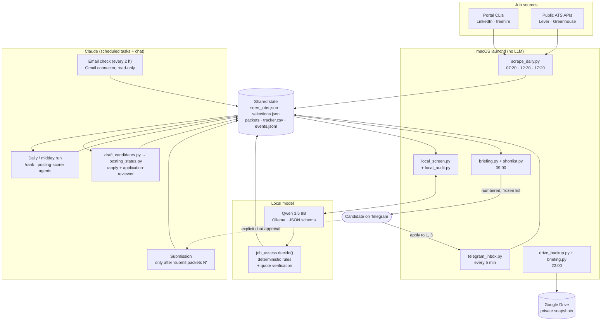

# AI Job Search Autopilot


A human-in-the-loop job-search automation that runs every day on a Mac: it discovers new software jobs,
screens them with a **local LLM (Qwen via Ollama)** under **deterministic, evidence-checked rules**, lets
**Claude** rank them and prepare tailored applications, and keeps the candidate in control of every
outbound action through **Telegram** and explicit chat approval.

It is an add-on to the open-source [ai-job-search](https://github.com/ai-job-search-dev/ai-job-search)
framework (MIT), which provides the portal CLIs, the `/scrape`, `/rank` and `/apply` Claude skills and the
LaTeX CV/cover-letter templates. This repository contains the autopilot layer built on top of it:
scheduling, local-model screening, safety rules, shortlist and approval flow, application packets, email
monitoring and backups.

**Tech stack:** Python 3 (stdlib + Pydantic) · Ollama with Qwen 3.5 9B · Claude (Claude Desktop scheduled tasks,
agents and skills) · Lever and Greenhouse public APIs · Telegram Bot API · Gmail, Calendar and Drive connectors ·
macOS launchd · LaTeX · pytest and GitHub Actions

> **Status:** Phase 1 is implemented and has run unattended for one candidate since November 2026.
> It discovers, screens, ranks, shortlists and prepares applications automatically. **Submission is
> never automatic**, and no application has yet been submitted end to end by the automation; the one real
> application so far was submitted by the candidate. See [Status and roadmap](#status-and-roadmap).

---

## Why

Applying for junior roles means checking several portals every day, discarding many postings that
cannot work (wrong country, senior, other language), and tailoring a CV and cover letter for the few
that fit. That is repetitive, but every step has a cost when it goes wrong: a fabricated skill, a missed
suitable job, or an application sent without the candidate's consent.

The design goal was therefore **maximum automation with hard safety boundaries**:

- cheap deterministic work and a local model handle volume;
- the expensive model (Claude) is used where judgement matters;
- a job is only rejected automatically with a **quote that verifiably appears in the posting**;
- nothing leaves the machine on the candidate's behalf without their explicit approval.

## Engineering highlights

- **LLM output treated as untrusted:** schema-validated JSON, with every evidence quote checked against the source
  text before it can affect a decision.
- **Model choice backed by measurement:** two local models compared on 47 unseen, independently labelled postings
  (accuracy, false negatives, latency, RAM and swap). The smaller model was chosen for equal decisions at a third
  of the memory. See [docs/benchmarks.md](docs/benchmarks.md).
- **Fail-safe by design:** every failure path (model missing, busy, out of memory, invalid output) falls back to
  human or Claude review instead of discarding a job. Audit sampling with an automatic switch-off catches drift.
- **Human-in-the-loop boundaries in code, not just policy:** frozen shortlist numbering, packet state machine,
  approval-gated submission, strict application-route matching.
- **Operational reliability:** file-locked state shared by independent schedulers, structured run logs, and
  verified, restore-tested backups.
- **Regression tests for every bug found in benchmarks** (27 tests, no network or model calls), run in CI.

## Key features

| Area | What it does |
|---|---|
| **Discovery** | Three times a day: LinkedIn and freehire portal CLIs, plus official employer boards through the public **Lever** and **Greenhouse** APIs. Deterministic title/location prefilter and deduplication. |
| **Local first-pass screening** | Qwen 3.5 (9B, via Ollama) extracts structured facts into a **JSON schema validated by Pydantic**. Rules in `job_assess.py`, not the model, decide **relevant / uncertain / irrelevant**. |
| **Evidence validation** | Every quote the model returns is checked against the posting text (HTML stripped). Unverifiable quotes are discarded. Missing information is `unknown`, never `ineligible`. |
| **Safety nets** | Every 3rd local rejection goes to Claude anyway (audit sample). Two missed suitable jobs in 14 days switch local screening off automatically. Memory-pressure guard, one model at a time, model unloaded after each run. |
| **Claude ranking and drafting** | Scheduled Claude runs score jobs with `posting-scorer` agents, select drafts deterministically, check the posting is still open and has a real application route, and draft a tailored LaTeX CV and cover letter, reviewed by an `application-reviewer` agent. |
| **Daily shortlist** | Hard eligibility gates first, soft fit second. Sent at 09:00 as a numbered Telegram list. Each published list is **frozen**, so replying to an old list never selects a different job. |
| **Approval flow** | A Telegram reply `apply to 1, 3` authorizes *preparation* only. Submitting requires an explicit `submit packets ...` message in a Claude chat, and a live check of the application form. |
| **Application packets** | Each prepared application is a packet with status (`ready_for_approval`, `approved`, `submitted`, `blocked`, `closed`, ...), route status and a form plan that maps form fields to pre-approved answers and pauses on anything else. |
| **Posting status and routes** | Three states: open / closed / unknown. For LinkedIn jobs it looks for the *same* job on the employer's own Lever/Greenhouse board using strict matching (employer identity, identical title, location, work mode, requisition ID, single candidate). |
| **Email monitoring** | Read-only (Gmail connector): classifies job and work mail by category and urgency, updates the tracker, and proposes calendar events for interviews (created only on request). |
| **Briefings** | 09:00 and 22:00 summaries: new matches, ready packets, email, upcoming interviews, health warnings. |
| **Backups** | Nightly verified snapshots to Google Drive: git bundle, data archive and a SHA-256 manifest. Never overwrites, fails loudly, restore-tested. |

## Architecture



**How the components communicate:** there is no message bus. Every step reads and writes small JSON
or CSV files in a shared state directory: the job store, selections, packets, the tracker and an
append-only event log. Writers reload before merging and take file locks (`fcntl`), so the launchd
jobs, the local model and Claude runs can overlap safely. Each component can be tested and re-run on
its own, and every decision leaves a record.

More detail: [docs/architecture.md](docs/architecture.md).

## Who decides what

| Responsibility | Qwen (local) | Deterministic code | Claude | Candidate |
|---|---|---|---|---|
| Extract facts (category, skills, years, languages, location quotes) | ✅ proposes | validates schema + quotes | | |
| Reject a job | ❌ never directly | ✅ only with a verified quote of a hard reason | reviews audit samples | |
| Rank / score fit | ❌ (its fit score is not used for ranking) | thresholds, gates | ✅ authoritative | |
| Choose what to draft | | ✅ caps, gates, priorities | | selects via Telegram |
| Write CV / cover letter | | | ✅ from the verified profile only | reviews |
| Submit an application | ❌ | ❌ | only after explicit approval | ✅ approves each packet |
| Send messages / emails to employers | ❌ | ❌ | ❌ (drafts only) | ✅ |

Why Qwen's fit score is not trusted: on 47 unseen, independently labelled postings its fit scores barely
correlated with Claude's (Spearman 0.17 for 9B, 0.04 for 35B), while its **fact extraction** was reliable.
So the local model reduces Claude usage only through quote-verified rejections and compact facts. See
[docs/benchmarks.md](docs/benchmarks.md).

## A day of operation (sanitized example)

1. **07:20** Discovery finds 23 new postings, and the prefilter drops 9 titles (e.g. "Data Annotator").
   Qwen screens 14: 3 are rejected with verified quotes (e.g. `senior: "at least 5 years of experience"`),
   11 are kept as relevant or uncertain, and 1 rejection is sampled for Claude to audit. The model is unloaded.
2. **07:47** The scheduled Claude run ranks the kept jobs, checks that the top two are still open with a
   real application route, and drafts a tailored CV and cover letter for each. The candidate is notified.
3. **09:00** Telegram receives the shortlist ([full example](examples/telegram_shortlist.txt)):

   ```text
   Job shortlist 2026-11-10-1 - reply e.g. 'apply to 1, 3' (numbers refer to THIS list only)

   1. [INTERN/NEW-GRAD] Backend Developer Intern (Java) - Example Labs
      Istanbul, Türkiye | home city onsite/hybrid | fit 78 | eligible | deadline 2026-12-01
      route: direct ATS form
   2. [JUNIOR] Junior Software Engineer - Acme Cloud
      Türkiye (Remote) | remote, Turkey | fit 71 | eligible
      route: LinkedIn (verified before submission)
   ```
4. The candidate replies `apply to 2`. Within 5 minutes the inbox job records the selection, and the next
   Claude run prepares the packet.
5. In a Claude chat the candidate reviews the PDFs and writes `submit packets 4`. Claude re-checks that the
   posting is open, fills only pre-approved answers, pauses on anything else, and records the application as
   submitted **only after the employer's confirmation page**.
6. **22:00** A verified backup snapshot goes to Google Drive, and the evening briefing summarises the day.

Real decision records produced by the rules on synthetic postings: [examples/assessment_examples.json](examples/assessment_examples.json).

## Security and human-approval boundaries

- **No automatic submission or outbound messages.** Telegram replies authorize preparation only.
  Every submission needs an explicit chat approval naming the packets, and a live form check.
- **Never invent facts.** CVs, cover letters and form answers come only from the verified candidate profile
  and a pre-approved answer file. Unknown questions pause the application.
- **Untrusted input stays data.** Job postings and emails pass an integrity gate, and instructions inside
  them are ignored. Model output is schema-validated, and quotes are verified against the source.
- **No bypassing.** No CAPTCHA solving, no login automation, robots.txt respected, honest user agents.
  Workable is not used because it rejects automated clients.
- **Least privilege.** Gmail and Calendar are read-only. Calendar events are only created on request.
  The backup folder is private and is never overwritten or deleted.
- **Secrets stay outside the repository** (`~/.config/...`, mode 600) and are never printed or logged.
- **Fail safe.** If the local model is missing, busy, out of memory or fails, jobs stay in the normal Claude
  queue. Nothing is silently discarded.

Details: [docs/security-model.md](docs/security-model.md) and [autopilot/AUTHORIZATION.md](autopilot/AUTHORIZATION.md),
the policy every automated run reads first.

## Requirements

- macOS (uses `launchd`, `memory_pressure`, Google Drive for desktop paths). Tested on an M1 Pro with 32 GB.
- Python 3.10+ with `pydantic` 2 (and `pytest` for the tests).
- A checkout of [ai-job-search](https://github.com/ai-job-search-dev/ai-job-search) (portal CLIs need `bun`).
- [Ollama](https://ollama.com) with a Qwen 3.5 model (`qwen3.5:9b`, about 8 GB resident). Optional: without it, everything goes to Claude.
- Claude Desktop with scheduled tasks for the ranking, drafting and email runs (prompts in `autopilot/prompts/`).
- Optional: a Telegram bot, Gmail and Calendar connectors, Google Drive for desktop, TinyTeX for the LaTeX documents.

## Setup

```bash
git clone https://github.com/ai-job-search-dev/ai-job-search.git job-search
git clone https://github.com/<you>/ai-job-search-autopilot.git
cp -R ai-job-search-autopilot/autopilot job-search/autopilot     # or symlink it and set JOB_SEARCH_ROOT
cd job-search
python3 -m pip install -r ../ai-job-search-autopilot/requirements.txt

cp autopilot/config.example.json autopilot/config.json            # private, git-ignored: edit candidate + sources
cp autopilot/form_answers.example.json autopilot/form_answers.json
ollama pull qwen3.5:9b                                            # optional local screening
python3 autopilot/telegram_setup.py                               # optional: stores the token in ~/.config, never prints it
PYTHON=$(command -v python3) bash autopilot/launchd/install.sh    # installs the launchd jobs with your paths
```

Then create the Claude Desktop scheduled tasks from `autopilot/prompts/daily_pipeline.md` (daily and midday)
and `autopilot/prompts/email_check.md` (every 2 hours). Configuration reference: [docs/configuration.md](docs/configuration.md).

## Tests

```bash
python3 -m pytest autopilot/tests -q        # 27 tests, no network, no model calls, temporary state only
```

The tests cover the screening rules, including these regressions found in benchmarks:
- "Uzman" titles treated as senior;
- programming languages mistaken for spoken languages;
- HTML-wrapped requirements;
- fabricated quotes;
- a wrong category rejecting a job.

They also cover frozen shortlist numbering, strict direct-route matching, the excluded-company gate,
model gating under memory pressure, and isolation of benchmark configuration from production.

Model benchmarks (`autopilot/bench_local.py`) need Ollama and a private, reviewed gold set
(format: `autopilot/bench_gold.example.json`).

## Status and roadmap

**Implemented and in daily use**
- launchd discovery, screening, briefings, Telegram shortlist and inbox, backups
- Qwen 9B first pass with audit sampling and automatic switch-off
- Claude ranking and drafting runs, packets, form plans, posting-status and route checks
- read-only email monitoring with tracker updates and calendar proposals
- continuous integration (pytest on macOS via GitHub Actions)

**Not yet demonstrated**
- An application submitted end to end by the automation. The submission flow exists (`prompts/submit.md`),
  but its first real use ended correctly as "closed" when the posting closed before submission.

**Planned**
- Longer-term evaluation of the local model on live postings (`local_report.py`, `local_audit.py`)
- A more general location and eligibility model (the prompt rules and the `remote_from_turkey` field are tuned to the Turkish job market today)
- Integration into a broader personal-assistant architecture

**Known limitations**
- macOS only.
- Depends on Claude Desktop scheduled tasks and on the upstream framework's portal CLIs.
- LinkedIn's signed-out view can hide closed postings, so a browser check is required before drafting.
- The local model's role-category accuracy is 76%, so it is never used to reject on its own.

## Repository layout

```text
autopilot/            the automation (Python, stdlib + pydantic)
  prompts/            instructions for the scheduled Claude runs (daily, email, submission)
  launchd/            launchd job templates + installer
  tests/              pytest suite
  config.example.json / form_answers.example.json / bench_gold.example.json
docs/                 architecture, configuration, security model, benchmarks
examples/             synthetic outputs produced by the real code
```

## Author

Ahmet Tarık Sevinç ([github.com/Ahmet-Tarik](https://github.com/Ahmet-Tarik)), software engineering student.

## Acknowledgments

This is my portfolio project: I defined the requirements, made the design, safety and model-selection decisions,
and operate the system daily. Development was assisted by [Claude Code](https://www.anthropic.com/claude-code),
which helped write and refactor the code, tests, benchmarks and documentation under my direction and review.

## Credits and license

Built on [ai-job-search](https://github.com/ai-job-search-dev/ai-job-search) by Mads Lorentzen and
contributors (MIT). See [NOTICE.md](NOTICE.md). This repository is released under the [MIT License](LICENSE).
