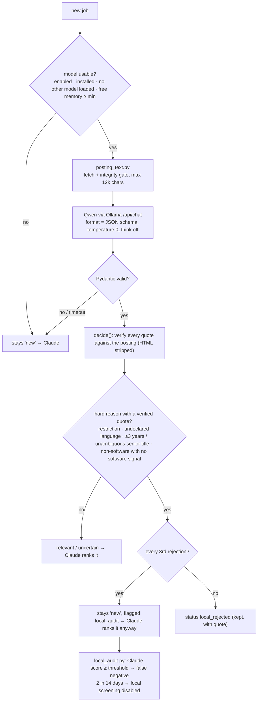

# Architecture

## Design principles

1. **Cheap work first.** Deterministic code (prefilter, deduplication, gates) and a local model handle the
   volume. Claude is used where judgement matters: ranking, drafting, review.
2. **Models propose, code decides.** The local model only proposes facts. A rejection needs a quote that
   is verified to exist in the posting, and every other outcome goes to Claude.
3. **Files as the interface.** Components communicate through small JSON/CSV files and an append-only event
   log, with file locks. Every step can be run, inspected and tested on its own.
4. **Human approval at the boundary.** Anything that leaves the machine on the candidate's behalf
   (applications, messages, calendar events) needs explicit approval.

## Schedules

| When | Runner | What |
|---|---|---|
| 07:20, 12:20, 17:20 | launchd → `run.sh scrape` | `scrape_daily.py` (portals + Lever/Greenhouse, prefilter, store) → `local_screen.py` (Qwen) → `local_audit.py --auto-disable` |
| 07:47, 13:48 | Claude Desktop scheduled task (`prompts/daily_pipeline.md`) | rank new jobs, prepare selections, choose and draft up to 2 applications, create packets |
| every 2 h, 08:05-22:05 | Claude Desktop scheduled task (`prompts/email_check.md`) | read-only Gmail check → `email_ingest.py` → tracker updates, alerts, calendar proposals |
| 09:00 | launchd → `run.sh morning` | `briefing.py morning`, `shortlist.py build --send` (publishes a frozen list to Telegram) |
| every 5 min | launchd → `run.sh inbox` | `telegram_inbox.py` (reads "apply to N" / "skip N" / "list") |
| 22:00 | launchd → `run.sh evening` | `drive_backup.py` (verified snapshot), `briefing.py evening` |
| on demand | Claude chat (`prompts/submit.md`) | submission of explicitly approved packets |

## Data flow and state

| File | Written by | Read by |
|---|---|---|
| `job_scraper/seen_jobs.json` (framework) | scrape, local screen (`local_*` fields only), `/rank` | everything downstream |
| `state/shortlists/<list_id>.json` + `shortlist_index.json` | `shortlist.py publish` (read-only after publishing) | `telegram_inbox.py` |
| `state/selections.json` | Telegram inbox, Claude runs | daily pipeline |
| `documents/applications/<slug>/packet.json` | `packets.py` | briefings, submission |
| `job_search_tracker.csv` (framework) | `/apply`, email ingest, submission | dedup, briefings |
| `logs/events.jsonl` | every component (`log_event`) | briefings, audits |
| `logs/local_screen.jsonl`, `logs/local_audit.jsonl` | local screen, audit | `local_report.py` |

Writers reload a file before merging their own fields, so a local-model run never overwrites a status that
Claude changed in the meantime. `single_instance()` file locks keep two copies of the same job from running.

## Local screening (`local_screen.py`, `job_assess.py`, `local_llm.py`)

Category and fit score are recorded as facts. They never reject a job on their own and are not used for
ranking. The model is unloaded after each run, and screening is skipped while any other model is loaded.

## Posting status and application routes (`posting_status.py`)

Three states: **open** (confirmed, e.g. a live Lever/Greenhouse posting), **closed** (confirmed), and
**unknown** (e.g. LinkedIn's signed-out view, which can hide "no longer accepting applications"). Unknown
postings may be prepared but are marked "route unverified", and a live form check is mandatory before
submission. For LinkedIn jobs, `match_direct_route()` looks for the same job on the employer's own
board. It accepts a match only when the employer identity is confirmed (known slug, Greenhouse board
name, or a Lever slug equal to the full company name), the core title tokens are identical, location and
work mode don't contradict, the requisition IDs match when both are stated, and exactly one candidate
remains.

## Telegram

`shortlist.py` publishes each list as an immutable file (mode 444) indexed by Telegram message ID.
`telegram_inbox.py` accepts commands only from the configured private chat. A reply to a specific list
message resolves numbers against *that* list; a plain message uses the latest list. Selections authorize
preparation only. Excluded companies are refused even if they appear on an older list.

## Backups (`drive_backup.py`)

Each run with changes writes a new `Backups/<timestamp>/` folder through Google Drive for desktop. The
folder holds a git bundle of all commits, a patch of uncommitted changes, a `data.tar.gz` of the
git-ignored personal data, a `MANIFEST.json` with the SHA-256 of every file, and `RESTORE.md`. It is
written as `.partial` and renamed only after every artifact read back from Drive matches its checksum. A
stopped app, paused sync or unreadable mount is reported as a failure, not as an empty success.
